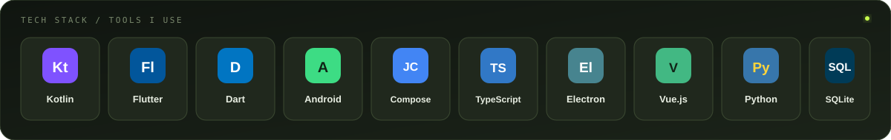

<div align="center">



### 把日常问题，做成顺手的产品。

Android / Flutter 开发者，喜欢把生活里的小麻烦变成真正可用的工具。

<p>
  <a href="https://github.com/bdpq"></a>
  <a href="mailto:empu@163.com"></a>
  
  
</p>

</div>

---

## 关于我

- 从真实问题出发，做功能完整、体验顺手的小产品。
- 活跃在 Android、Flutter 与桌面端，常用 Kotlin、Dart、TypeScript、C++ 和 Python。
- 在多个项目中实践本地存储、离线可用与数据隐私优先。
- 喜欢把复杂功能拆清楚，也愿意在交互、性能和边界条件上继续打磨。

```text
$ whoami
> bdpq — Android / Flutter / Desktop developer

$ cat philosophy.txt
> build useful things
> keep data local
> polish the details
```

## 技术栈

<div align="center">
  
</div>

<p align="center">
  
  
  
  
  
  
  
</p>

## 精选项目

<div align="center">


</div>

## 项目清单

| 项目 | 简介 | 技术栈 |
| :--- | :--- | :--- |
| [CalendarDiary](https://github.com/bdpq/CalendarDiary) | 集日历、农历、多媒体日记、事项与精确提醒于一体的离线 Flutter 应用。 | Flutter · Dart · SQLite |
| [Bookkeeping](https://github.com/bdpq/Bookkeeping) | 支持通知与短信自动解析、离线语音记账的 Android 应用，数据仅保存在本地。 | Kotlin · Compose · Room |
| [Stock-Monitor](https://github.com/bdpq/Stock-Monitor) | Windows 轻量悬浮行情面板的离线维护版，支持自选股、价格提醒与透明置顶窗口。 | Electron · Vue 3 · TypeScript |
| [LocationAlarm](https://github.com/bdpq/locationalarm) | 根据位置触发闹钟提醒，让通知发生在真正需要的时候。 | Kotlin · Compose · Room |
| [DyDown](https://github.com/bdpq/DyDown) | 自用 Android 下载工具，支持单条视频、图集、主页批量与直播录制。 | Kotlin · Compose · WebView · yt-dlp |
| [zdbs](https://github.com/bdpq/zdbs) | 整点报时 APK 逆向分析与研究工作区。 | APKTool · Smali · C |
| [ideacalc](https://github.com/bdpq/ideacalc) | 计算管家 APK 静态安全分析、审计报告与验收脚本。 | Python · Androguard · JADX |
| [wallpaper](https://github.com/bdpq/wallpaper) | Wallpaper Changer APK 分析、Smali 修复与中文本地化工作区。 | Smali · Python · APKTool |
| [QuickDesk](https://github.com/barry-ran/QuickDesk) | AI 原生远程桌面，内置 MCP Server，支持 AI Agent 远程操作。 | C++ · Qt 6 / QML · MCP · WebRTC |

<sub>QuickDesk 使用公开上游仓库链接。</sub>

## GitHub 数据

<div align="center">


</div>

## 当前关注

- 移动端：Compose、Flutter、离线数据与系统能力整合。
- 桌面端：Electron、Qt / QML、远程控制与 AI Agent 工具链。
- 工程实践：可复现构建、自动化验收、隐私优先与细节打磨。

## 联系我

如果有产品灵感、技术交流，或者只是想打个招呼，欢迎联系：

- GitHub：[@bdpq](https://github.com/bdpq)
- Email：[empu@163.com](mailto:empu@163.com)

<div align="center">


</div>
