### 把日常问题，做成顺手的产品。

Android / Flutter 开发者，喜欢把生活里的小麻烦变成真正可用的工具。

  
  
  
  

ISSUE 01 — NOTES ON CODE, TOOLS & EVERYDAY PROBLEMS

---

## 01 / PROFILE

> **Editor's note.** 我从真实问题出发，做功能完整、体验顺手的小产品；也在意功能之外的细节：数据放在哪里、界面是否清楚、边界条件是否可靠。

活跃在 **Android、Flutter 与桌面端**，常用 Kotlin、Dart、TypeScript、C++ 和 Python。这些开源项目既是工具，也是我持续记录学习、验证想法的方式。

- 移动端：Compose、Flutter、离线数据与系统能力整合。
- 桌面端：Electron、Qt / QML、远程控制与 AI Agent 工具链。
- 工程实践：可复现构建、自动化验收、隐私优先与细节打磨。

---

## 02 / THE TOOLKIT

  

  
  
  
  
  
  
  

---

## 03 / COVER STORY

  

### CalendarDiary — 一本会提醒你的离线日记

日历、农历、多媒体日记、事项与精确提醒，被装进一个 Flutter 应用。数据留在本机，记录生活，也照顾每一个提醒。

**本月精选：** [CalendarDiary](https://github.com/bdpq/CalendarDiary) · [Bookkeeping](https://github.com/bdpq/Bookkeeping) · [Stock-Monitor](https://github.com/bdpq/Stock-Monitor)

---

## 04 / PROJECT INDEX

| No. | 项目 | 故事 | 技术栈 |
| :---: | :--- | :--- | :--- |
| 01 | [CalendarDiary](https://github.com/bdpq/CalendarDiary) | 集日历、农历、多媒体日记、事项与精确提醒于一体的离线 Flutter 应用。 | Flutter · Dart · SQLite |
| 02 | [Bookkeeping](https://github.com/bdpq/Bookkeeping) | 支持通知与短信自动解析、离线语音记账的 Android 应用，数据仅保存在本地。 | Kotlin · Compose · Room |
| 03 | [Stock-Monitor](https://github.com/bdpq/Stock-Monitor) | Windows 轻量悬浮行情面板的离线维护版，支持自选股、价格提醒与透明置顶窗口。 | Electron · Vue 3 · TypeScript |
| 04 | [LocationAlarm](https://github.com/bdpq/locationalarm) | 根据位置触发闹钟提醒，让通知发生在真正需要的时候。 | Kotlin · Compose · Room |
| 05 | [DyDown](https://github.com/bdpq/DyDown) | 自用 Android 下载工具，支持单条视频、图集、主页批量与直播录制。 | Kotlin · Compose · WebView · yt-dlp |
| 06 | [zdbs](https://github.com/bdpq/zdbs) | 整点报时 APK 逆向分析与研究工作区。 | APKTool · Smali · C |
| 07 | [ideacalc](https://github.com/bdpq/ideacalc) | 计算管家 APK 静态安全分析、审计报告与验收脚本。 | Python · Androguard · JADX |
| 08 | [wallpaper](https://github.com/bdpq/wallpaper) | Wallpaper Changer APK 分析、Smali 修复与中文本地化工作区。 | Smali · Python · APKTool |
| 09 | [QuickDesk](https://github.com/barry-ran/QuickDesk) | AI 原生远程桌面，内置 MCP Server，支持 AI Agent 远程操作。 | C++ · Qt 6 / QML · MCP · WebRTC |

QuickDesk 使用公开上游仓库链接。

---

## 05 / BY THE NUMBERS

---

## 06 / COLOPHON

如果有产品灵感、技术交流，或者只是想打个招呼，欢迎联系：

- GitHub：[@bdpq](https://github.com/bdpq)
- Email：[empu@163.com](mailto:empu@163.com)

